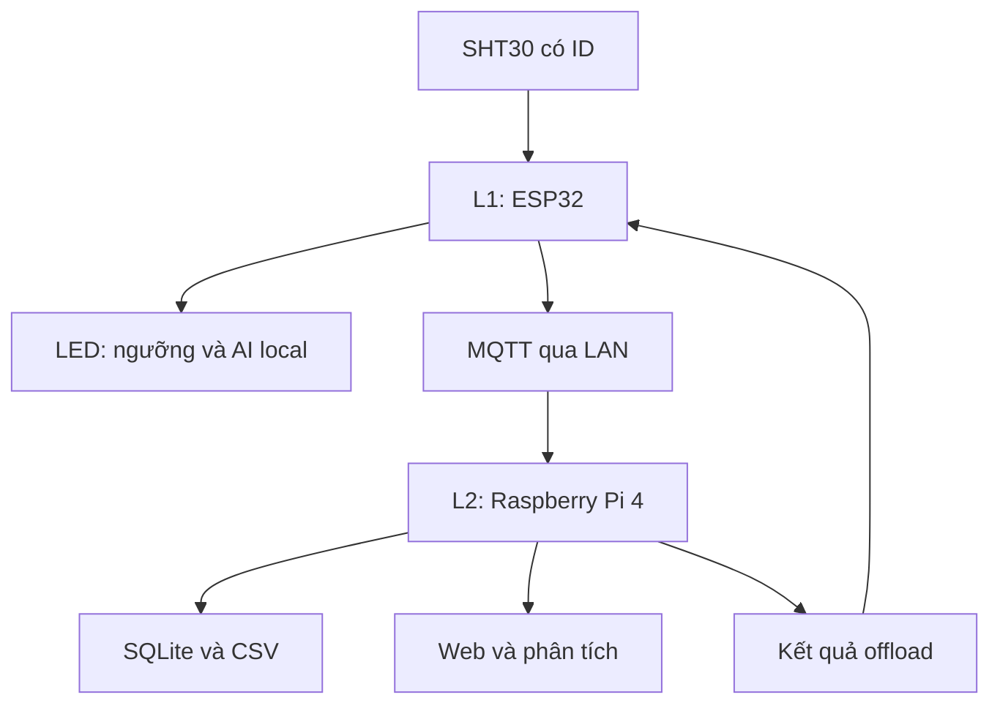

# Kiến trúc hệ thống và phạm vi

## Hai mức xử lý tại biên

ESP32 là L1: thu thập, kiểm tra dữ liệu, so ngưỡng, suy luận nhẹ, quyết định gửi/offload.
Pi 4 là L2: broker MQTT, lưu trữ, phân tích cửa sổ dài, giao diện người dùng, điều phối tác vụ.
Kết nối hiện tại là Wi-Fi hình sao qua router/AP, không phải mesh. Pi chưa được cấu hình làm Wi-Fi AP trong gói này.
Một ESP32 quản lý 2–3 SHT30 là một node đa cảm biến. Đây chưa phải mạng nhiều node ESP32; mở rộng bằng NODE_02, NODE_03 và client ID riêng.



Chatbot gọi API ngoài từ Pi là nhánh cloud phụ trợ. Mất Internet không làm dừng cảnh báo L1 hoặc MQTT LAN.
Nhánh web, chatbot, model mạnh là thiết kế tiếp theo, chưa phải phần mềm đã triển khai trong gói.

## Thư mục hiện có

```text
EdgeEnv_TwoTier/
  README.md
  firmware/EdgeEnvNode/
    EdgeEnvNode.ino       vào chương trình, SHT30, AI, MQTT
    Config.h              chân, ID, địa chỉ, ngưỡng, chu kỳ
    Logic.h               CRC, hysteresis, buffer độc lập
    RuntimeTypes.h        cấu trúc trạng thái dùng chung
  gateway/
    service.py            MQTT → SQLite, CSV, offload response
    analysis.py           baseline xu hướng tuyến tính
    requirements.txt
    .env.example
  web/
    README.md             đặc tả giao diện/API, chưa có website
  models/
    README.md             hợp đồng model và cách train 1 Hz
  docs/
    ARCHITECTURE.md
    HARDWARE.md
    PROTOCOL.md
    DEPLOYMENT.md
    TEST_PLAN.md
    SOURCES.md
    VALIDATION.md         kết quả kiểm thử máy chủ
  tests/
    test_logic.cpp
    test_gateway.py
```

## Cấu trúc mục tiêu khi triển khai đầy đủ

Các mục dưới là đường dẫn dự kiến, **chưa có file thực thi tương ứng**:

| Đường dẫn dự kiến | Trách nhiệm |
|---|---|
| gateway/app/mqtt_worker.py | Thu nhận MQTT và điều phối worker |
| gateway/app/storage.py | Truy vấn, retention, chỉ mục dữ liệu |
| gateway/app/offload_worker.py | Model mạnh, timeout và kết quả |
| gateway/app/forecast.py | Dự báo, sai số, độ tin cậy |
| gateway/app/api.py | FastAPI, xác thực, WebSocket |
| gateway/app/chat.py | Gọi API LLM, chỉ cho phép công cụ đọc dữ liệu |
| gateway/app/settings.py | Biến môi trường và giới hạn |
| web/src/pages/Overview.tsx | Realtime và nguồn dữ liệu |
| web/src/pages/History.tsx | Biểu đồ, vùng nổi bật, CSV |
| web/src/pages/Experiments.tsx | So sánh local/offload và truyền tin |
| web/src/components/ChatPanel.tsx | Hỏi đáp dựa dữ liệu được truy vấn |
| deployment/ | Mosquitto ACL, service systemd, backup |
| experiments/ | Kịch bản, log gốc, kết quả đo và biểu đồ |

## Phân tách xử lý trên ESP32

- `SensorTask` lấy mẫu, quản lý buffer và chạy AI nối tiếp, cập nhật LED.
- `loop()` là luồng mạng: Wi-Fi, MQTT, gửi sự kiện và snapshot, theo dõi offload.
- Mutex bảo vệ snapshot; inference và I²C chỉ có một task truy cập.
- Event queue 16 phần tử, không có flash spool. Full: bỏ sự kiện mới, tăng đếm.
- Kết nối broker có thể chặn luồng mạng; không chặn SensorTask. Trễ inference vẫn cần đo.
- Không tách quá nhiều task chỉ để đáp ứng tên môn; trọng tâm môn Hệ thống Viễn thông là luồng dữ liệu, MQTT, QoS, băng thông, độ trễ và phân cấp xử lý.

## Gộp và giảm truyền thông

Chỉ gộp một cặp cùng zone khi mọi điều kiện đúng: nguồn hợp lệ, mẫu không quá 3 giây, nhiệt lệch ≤0.5°C, ẩm lệch ≤3%RH, không báo ngưỡng/AI, cả hai AI `ready`.
Thông số chênh lệch là giá trị khởi đầu để hiệu chỉnh, không phải sai số đảm bảo của phần cứng.
Gộp xong giữ `source_ids`, spread, timestamps nguồn. Cảnh báo từng nguồn xét trước phép trung bình.
Payload MQTT định kỳ luôn là một message; nếu không gộp, nó chứa nhiều records. Vì vậy đo **số byte** thay vì chỉ đếm messages để chứng minh lợi ích phép gộp.
Gửi 5 giây/lần giảm truyền so với gửi từng mẫu 1Hz. Không được suy ra năng lượng tiết kiệm theo cùng tỷ lệ số byte: Wi-Fi còn kết nối, CPU còn chạy.
Hai điểm đo khác vị trí không được gộp chỉ vì cùng nhiệt độ. Hai cảm biến cùng nóng không phải là bình thường chỉ vì gần nhau.

## Offload

Gói hiện tại gửi 15 mẫu thực của một cảm biến, có thời gian tương đối; Pi trả baseline tuyến tính. Model mạnh phải được bổ sung và đánh giá để hoàn tất mục tiêu nghiên cứu trong kế hoạch.
Chính sách 0 tắt, 1 theo độ không chắc chắn, 2 luôn offload theo lịch; local vẫn chạy để duy trì cảnh báo.
Chế độ 2 là **local + always-offload bổ sung**, không phải thực nghiệm always-offload thuần. Muốn so sánh các chiến lược, cần xây harness tách riêng tác vụ được đo nhưng luôn giữ lớp ngưỡng bảo vệ.
Chưa có đo năng lượng hay hàm cost tối ưu. Không tuyên bố chính sách thông minh tốt hơn trước khi có số liệu.

Ưu tiên tiếp theo: hoàn thiện 1Hz + AI → kiểm thử nhiều cảm biến → MQTT/lưu trữ → UI → model mạnh và đo offload → dự báo/chatbot.
